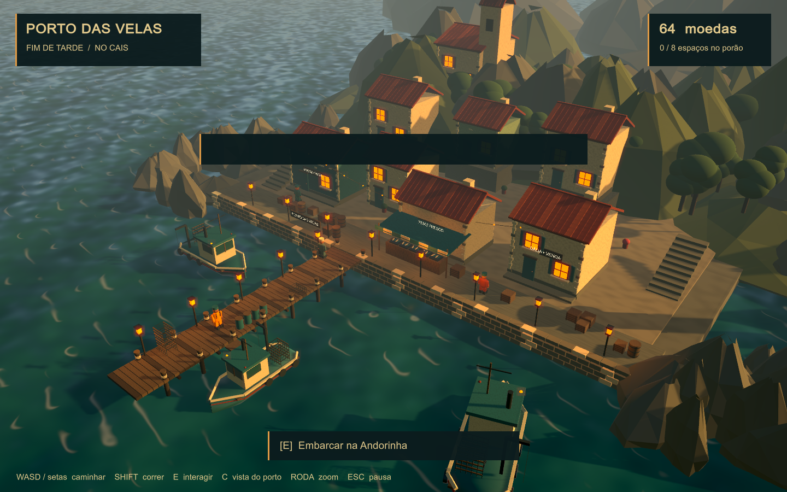

# Tide · Maré de Ferro

Protótipo de uma aventura de pesca, vida em comunidade e comando de embarcações. Um sobrevivente de naufrágio encontra abrigo em Porto das Velas e começa a construir sua vida no mar.

## Abrir no Unity

1. Instale **Unity 6000.0.85f1** com suporte a builds Windows.
2. No Unity Hub, adicione a pasta **mare-de-ferro/Unity**.
3. Abra **Assets/Scenes/PortoDasVelas.unity** e pressione **Play**. O cenário é construído por código ao iniciar.

Os diretórios `Library`, `Temp`, `Logs`, `UserSettings` e `Builds` são gerados localmente e não são versionados. Assets, arquivos `.meta`, configurações do projeto e dependências fazem parte do repositório.

## Gerar o jogo para Windows

No editor, use **Maré de Ferro → Criar cena e gerar Windows**. O executável será criado em **mare-de-ferro/Builds/Windows/MareDeFerro.exe**. Depois da geração, **mare-de-ferro/JOGAR.bat** abre o jogo.

## O que já funciona

- Caminhada pelo cais, câmera e diálogos iniciais.
- Embarque, navegação na enseada e desembarque.
- Três covos, minigame de tensão e quatro tipos de captura no inventário.
- Venda no mercado e salvamento de moedas e inventário.
- Freio, colisões do casco, atracação segura, porão de oito capturas e pausa da simulação.
- Salvamento com cópia de segurança e persistência da espera dos covos.
- Água animada, iluminação de fim de tarde, barcos flutuantes e som ambiente.

O visual é uma primeira construção procedural, ainda distante do nível de detalhe das artes conceituais. As criaturas ainda não têm modelos próprios no convés. Temporadas, frotas competitivas, demais mares e campanha completa estão planejados no brief.

## Documentação

- [Brief criativo e direção de arte](mare-de-ferro/BRIEF-CRIATIVO.md)
- [Controles e primeira viagem](mare-de-ferro/COMO-JOGAR.md)
- [Validação da base e ajustes da versão 0.2](mare-de-ferro/BASE-JOGAVEL.md)
- [Artes conceituais](mare-de-ferro/LEIA-ME.md)
- [Prompts das imagens geradas por IA](mare-de-ferro/PROMPTS-ARTE.md)
- [Verificação do executável](mare-de-ferro/verificacao/LEIA-ME.md)

## Próximas etapas recomendadas

1. Ajustar câmera, navegação, interação e sensação do guincho com testes de jogo.
2. Produzir um pequeno trecho do cais com qualidade visual próxima da referência: modelos, materiais, água e iluminação.
3. Criar a interface definitiva para esse mesmo trecho: diálogo, captura, mercado e diário.
4. Completar uma temporada curta com progressão de barco e um capitão rival.
5. Expandir o conteúdo usando os padrões visuais e mecânicos aprovados.

A interface atual usa IMGUI para prototipagem. A apresentação final precisa manter as regras de jogo separadas dos painéis para permitir trocar a interface sem refazer pesca, inventário e economia.
