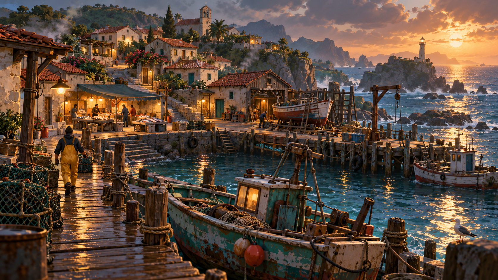
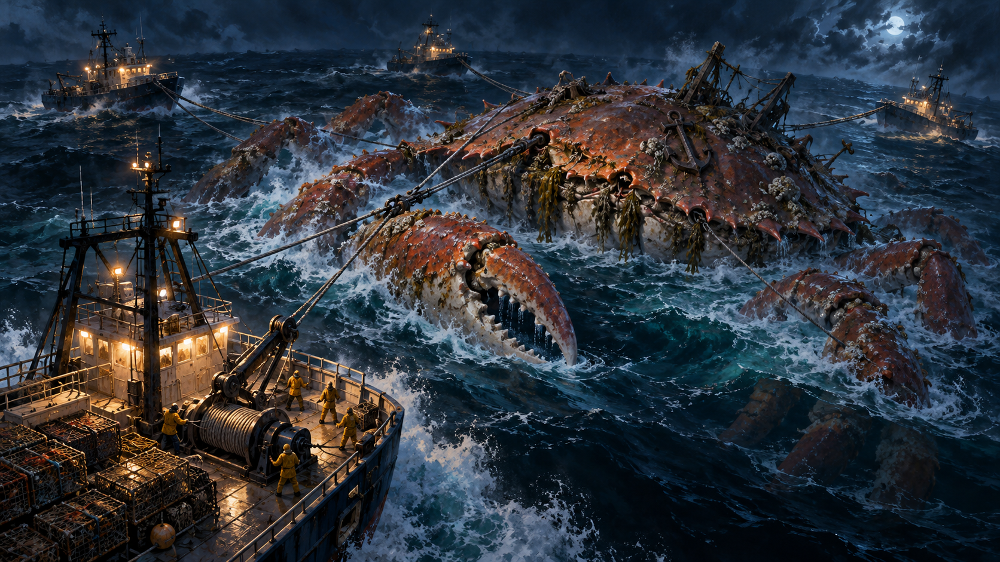
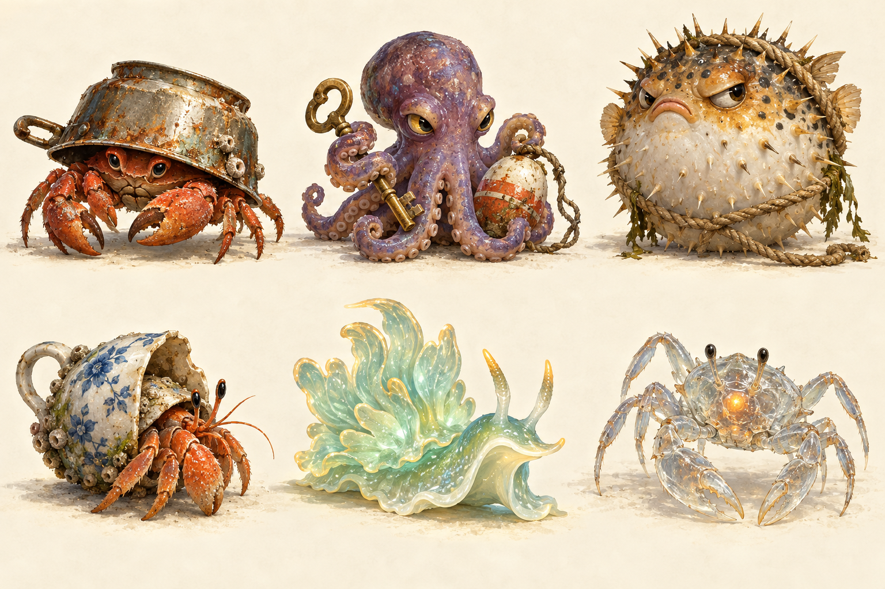

# Maré de Ferro — pacote criativo

**Uma vida para construir em terra. Um gigante para encontrar no mar.**

## Primeiro protótipo jogável

Abra **JOGAR.bat** ou **Builds/Windows/MareDeFerro.exe**. Veja [controles e escopo](COMO-JOGAR.md). O projeto editável está em **Unity/**; a cena constrói o porto ao entrar em Play. As imagens abaixo são referências conceituais; imagens reais do protótipo estão em **verificacao/**.

- [Brief criativo completo](BRIEF-CRIATIVO.md): visão, história, personagens, frotas, temporadas, mecânicas, mares e direção de arte.
- [Prompts integrais](PROMPTS-ARTE.md): instruções utilizadas na geração das ilustrações.

## Porto das Velas
Estudo de atmosfera: um porto de trabalho, com desgaste, luz acolhedora e espaços para a vida em comunidade. O nível de detalhe desta arte é maior que o proposto para os elementos jogáveis.

## A captura do Rei
Estudo de escala, iluminação e formação da frota. O desafio final parte das ferramentas de pesca que acompanham o jogador desde o início.

## As surpresas dos covos
Exploração de silhuetas e personalidade para seis criaturas. Humor e descoberta continuam presentes mesmo quando a história fica mais tensa.

Todas as imagens são conceitos gerados por IA, sujeitos a revisão. Este pacote documenta a proposta criativa; o jogo ainda não foi implementado.
